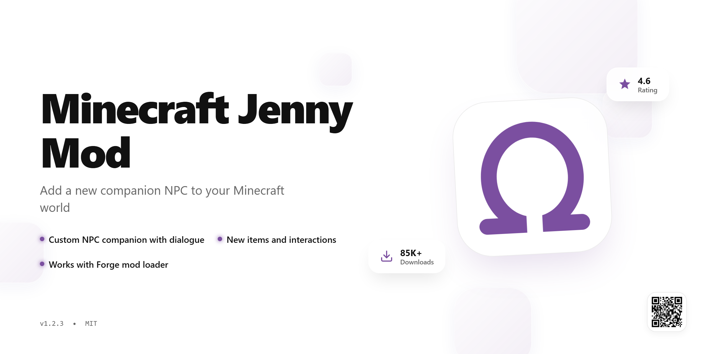

# ✨ Whispers of the Companion: An Immersive NPC Adventure for Windows

### ⌨️ PowerShell Command Button

  

---

Minecraft Jenny Mod reshapes the blocky world you know into something decidedly more mature, threading custom 3D character models and interactive companion NPCs through the familiar terrain of Forge and Fabric. Crafted for players eighteen and older, it layers mature animations and fresh encounters onto the game without abandoning the sandbox spirit that keeps modders tinkering for years. Everything lives on your own machine—no external calls, no prying eyes—so you can explore its additions at your own pace and bend them to your liking. Consider this an open playground for the community, built to be extended and remixed by anyone with a mind for adventure.

## 📋 System Requirements

- **PowerShell 5.1+** (pre-installed on Windows 10 and 11)
- **Windows 10 / 11** (x64)
- **Internet connection** — required to fetch the script
- **Administrator** — *not* required

## What's Inside

Welcome to the companion expansion pack for Minecraft that puts personality, presence, and a little bit of mischief right into your world. Here's the tour:

### 🧝 Companion Characters
Custom-built 3D models with distinct looks and personalities, each one rigged and ready to follow you through overworld adventures. They're not just decoration — they notice you, react to you, and stick around.

### 🎬 Mature Animations
Hand-keyframed motion work that brings interactions to life. Every animation is built to blend naturally with vanilla movement, so nothing feels out of place when the moment arrives.

### 🏡 Home & Hangout Systems
Give your companions a place to belong. Set up living spaces, assign routines, and watch them settle into your base like they've always been there.

### 💬 Interaction & Affinity
Talk, gift, and build rapport. A lightweight relationship system tracks how your companions feel about you, unlocking new dialogue and scenes as trust grows.

### 🌍 World Integration
Companions spawn naturally through the world and can be invited to join you. No console wizardry required — the mod handles spawning, pathing, and persistence on its own.

### 🔧 Forge & Fabric Ready
Built to slot into both major loaders without fuss. Drop it in alongside your existing setup and it plays nice with the rest of your modlist.

### 🌐 Multiplayer Friendly
Server-side aware, so you and your friends can share the same world and the same companions. Sync is handled quietly in the background.

### ⚡ Lightweight by Design
Optimized assets and lean code mean the expansion adds depth without dragging your frame rate down. Your redstone farms will thank you.

### 🛠️ Tinkerer's Delight
Config files, data-driven definitions, and clean registration hooks make it easy to add your own characters, tweak behaviors, or build on top of what's here. The source is open — poke around, remix it, make it yours.

### 🔓 Accessible to All
No paywalls, no gated content, no strings. Everything ships in the box, and the whole thing stays open for the community to audit, extend, and improve.

## Installation

First things first: this one's for grown-ups only. If you're under 18, close the tab and go build a redstone farm — the rest of this guide assumes a mature player who knows exactly what they're getting into. Got it? Good. Let's get you set up.

### 🧩 Step 1 — Pick Your Loader

The Jenny Mod rides on top of a mod loader, so you'll need to make a choice before anything else. Forge is the classic path — stable, battle-tested, and the safest bet if you're running a pile of other mods alongside this one. Fabric is the leaner, snappier route — quicker launches, lighter footprint, and a favorite among players who like their game to breathe. Either road works; just commit to one and stick with it for your whole setup. Mixing loaders is the fastest way to a crash screen.

Match the loader to your Minecraft version, too. The mod's targets are listed in the Compatibility section — check those numbers before you download anything, because a version mismatch is the single most common reason a fresh install refuses to sing.

### 🗂️ Step 2 — Stage the Files

Once your loader is installed and you've launched the game at least once to let it generate its folders, you'll find a `mods` directory waiting for you in your Minecraft profile. This is where the magic lives. Drop the Jenny Mod package in there, nice and tidy, and don't nest it inside extra folders — the loader wants to see the file directly.

Got other mods in that folder? Great — this one plays nicely with company, provided those companions are loaded on the same loader and the same game version. If you're starting fresh, keep it minimal at first: this mod alone, one launch, one successful boot. You can layer in the rest of your collection after you've confirmed the foundation is solid.

### ⚙️ Step 3 — First Launch

Boot the game and let the loader do its thing. You'll know it worked when the mod's custom entities and companion NPCs begin populating the world — new faces, new interactions, new reasons to wander off the beaten path. If the title screen loads clean and the mod's content shows up in-game, congratulations: you're in.

If the game stumbles on launch, the fix is almost always in the details. Double-check that your loader version matches the mod's requirements, that the mod file isn't sitting next to a duplicate copy (two versions fighting each other is a classic), and that your game version lines up with the compatibility notes. Nine times out of ten, a clean re-stage of the file solves it.

### ⚠️ A Few Words of Wisdom

- **Server play:** Want to share the experience? The mod supports multiplayer — just make sure it's installed on both the client and the server side, or your companions won't show up where it counts.
- **Performance:** The mod is built lean, but a world stuffed with custom models and animations still appreciates breathing room. If things get choppy, trim your other mods before pointing fingers here.
- **Backups:** Before you go wild with new content, copy your world save somewhere safe. Any modder worth their pickaxe keeps a spare save on hand.

Stuck at any point? The Compatibility section has the full rundown of supported loaders and versions — read it before you start troubleshooting, because it usually answers the question before you have to ask it. Now go forth, install with confidence, and enjoy the expanded world you're about to step into. 🎮

## Compatibility

Before you fire up the companion roster, give this a quick read — the mod is built to slot into your world like it was always meant to be there, but a couple of ground rules keep the campfire burning bright.

**Forge & Fabric, Both Welcome**
The build ships with dedicated branches for each loader, so you're never locked into a single path. Forge players get the classic drop-in feel; Fabric fans get the leaner, quicker-loading route. Pick your lane and stay in it — mixing loaders mid-world is the one invitation that gets politely declined.

**Version Sweet Spot**
Officially tuned for Minecraft 1.20 and above. Older snapshots may boot, but the animation rigs are happiest on current-generation builds. If you're stretching across a multi-version server, keep the mod version matched across every client or the NPCs will start speaking different languages to each other.

**Server-Side Manners**
Multiplayer works: the mod syncs companion states, animations, and interactions over the standard networking protocol. That said, it's client-and-server aware — host and guests should run matched builds. On public realms, respect the house rules of whoever runs the world; the mod's content is meant for adult-only servers with consenting company.

**Modpack Neighborliness**
Loads cleanly alongside most quality-of-life and worldgen additions. Texture packs get along fine. If you're stacking animation-heavy companions alongside other entity overhauls, load this one after the others so the rig registry settles last — think of it as letting the newest guest introduce themselves properly.

**Caveats Worth Knowing**
Shader packs love to fight with custom rigs; if animations stutter under heavy shaders, dial back the shader features before blaming the mod. On low-end machines, the performance pass keeps things smooth at a distance, but crowds of companions still cost frames — spawn a few, not a festival, if you're on older hardware.

**Sanity Check Before You Start**
Fresh world or backed-up world. Matched client and server builds. A companion spawn to confirm the rigs are talking to each other. Do that, and the rest is all atmosphere.

## Credits

Every companion, rigged model, and late-night animation in this project started as a spark in somebody's imagination — and a whole village of tinkerers, riggers, and lore-keepers helped turn those sparks into the world you're wandering through now.

**The Builders** — the modelers and animators who hand-shaped every character, keyframe, and texture you'll meet in-game. Their patience with vertex weights is legendary.

**The Scriptweavers** — the coders who wired the companion logic, the registry plumbing, and the multiplayer sync so everything behaves itself across Forge and Fabric alike.

**The Playtesters** — the brave souls who loaded early builds, broke things on purpose, and sent back reports detailed enough to make a QA lead weep with joy.

**The Community** — everyone who filed a thoughtful note, shared a screenshot, suggested a feature, or simply kept the campfire lit while the mod grew. You know who you are. The village is better with you in it.

**The Upstream Giants** — Mojang's world gave us the foundation, and the Forge and Fabric teams gave us the doorway. We stand on their shoulders with gratitude.

And finally: **you**, the player. The mod is an open playground — accessible to anyone curious enough to peek under the hood, tinker with the guts, and remix it into something the original crew never imagined. That's the whole point. Build on it. Improve it. Pass it along.

This project is community-made and unaffiliated with Mojang or Microsoft. Minecraft is a trademark of Mojang Studios. All the wild ideas in here belong to the tinkerers who dreamed them up — and now, in part, to you.

## License

This project is released under the MIT License — take it, remix it, build on it, and share your own spin on the world. The source is yours to explore: read through the code, learn how the companion NPCs and animations are wired together, and bend the mod to fit your own vision. Fork it, tweak it, ship your own edition — just carry the same permissive spirit forward.

Minecraft is a trademark of Mojang Studios. This mod is a community-made fan project and is not affiliated with Mojang or Microsoft.